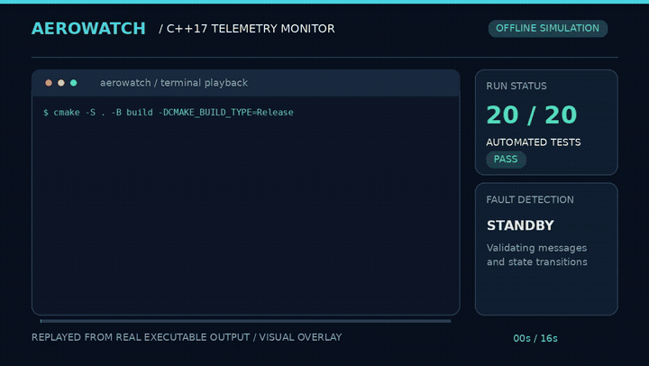

# AeroWatch — C++ Telemetry Monitoring Simulator

A cross-platform, **C++17** offline simulator for generating, validating, replaying, and monitoring synthetic uncrewed-vehicle telemetry. Built to demonstrate object-oriented design, reliable data processing, fault handling, automated tests, and CI.

**Safety and scope:** Educational simulator only. Does not connect to, command, or operate any vehicle; does not implement MAVLink or STANAG 4586. All telemetry is synthetic.

## 🎬 Working demo

[](media/demo.mp4)

**[▶ Watch the 16-second video demo (MP4)](media/demo.mp4)** · [View the animated GIF](media/demo.gif)

This demo shows a visual playback of **actual compiled C++ program output**, including 20 passing tests, 22 accepted synthetic telemetry records, two safely rejected faults, and NOMINAL → WARNING → CRITICAL health transitions.

The styled terminal and telemetry panels are a presentation overlay on real CLI data, **not a GUI built into the C++ application**. The demonstration is offline and does not communicate with any vehicles.

To regenerate the video and GIF locally: build the project and run all tests, install Python Pillow and FFmpeg, then run `python3 scripts/render_demo.py`. The repository's **Publish project demo** GitHub Actions workflow also regenerates the files automatically.

## Features

- Simulated telemetry for two independent vehicles
- CSV validation (8 typed fields, range checks, invalid packet handling)
- Vehicle-specific telemetry state with duplicate and out-of-order packet rejection
- Four health statuses: NOMINAL, WARNING, CRITICAL, OFFLINE
- Configurable battery and link thresholds, staleness detection, and exponential smoothing
- Deterministic fault-injection mode (malformed messages and stale messages)
- Sample data and CSV export/replay
- Python CSV summary utility
- 20 CTest cases and GitHub Actions CI targeting Linux, Windows and macOS

## Requirements

CMake 3.16+ and a C++17 compiler (GCC, Clang, or MSVC). No third-party libraries.

## Build and test

```bash
cmake -S . -B build -DCMAKE_BUILD_TYPE=Release
cmake --build build --config Release
ctest --test-dir build -C Release --output-on-failure
```

## Run

On Linux/macOS:

```bash
./build/aerowatch --samples 24
./build/aerowatch --samples 24 --faults
./build/aerowatch --samples 24 --csv-out telemetry.csv
./build/aerowatch --replay examples/telemetry_sample.csv
python3 scripts/summarize.py examples/telemetry_sample.csv
```

For Visual Studio Windows builds, run `build\\Release\\aerowatch.exe` instead.

## Architecture

| Path | Role |
| --- | --- |
| `include/aerowatch/telemetry.hpp`, `src/telemetry.cpp` | Telemetry data model, serializer and strict parser |
| `include/aerowatch/monitor.hpp`, `src/monitor.cpp` | Object-oriented health monitoring and per-vehicle state |
| `include/aerowatch/simulator.hpp`, `src/simulator.cpp` | Deterministic telemetry generator and fault injection |
| `src/main.cpp` | CLI and CSV replay/export |
| `tests/test_main.cpp` | 20 regression tests exposed through CTest |
| `scripts/summarize.py` | Lightweight Python analysis |
| `.github/workflows/ci.yml` | Cross-platform build/test matrix |

### Synthetic telemetry format

```csv
timestamp_ms,vehicle_id,latitude_deg,longitude_deg,altitude_m,speed_mps,battery_percent,link_percent
1000,ALPHA01,51.040000,-114.070000,120.00,12.00,92.00,97.00
```

Each vehicle's latest observation determines its health. A stale observation older than 3500 ms is OFFLINE; otherwise battery or link at/below 20% is CRITICAL; battery at/below 35% or link at/below 45% is WARNING; otherwise NOMINAL. Smoothing is shown separately and does not delay critical alerts. Thresholds are configurable.

## Engineering notes

Data parsing rejects malformed and out-of-range records. Monitoring rejects duplicated and out-of-order timestamps without overwriting previously accepted data. The simulator is deliberately reproducible so test and CI failures can be investigated reliably.

The default GitHub Actions workflow runs on each push and pull request. If uploading files one at a time, each push starts a separate run. For future bulk updates, commit all files locally and push once to avoid unnecessary CI notifications.

## License

MIT — see `LICENSE`.
